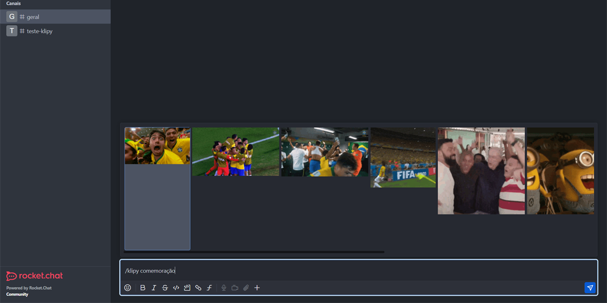
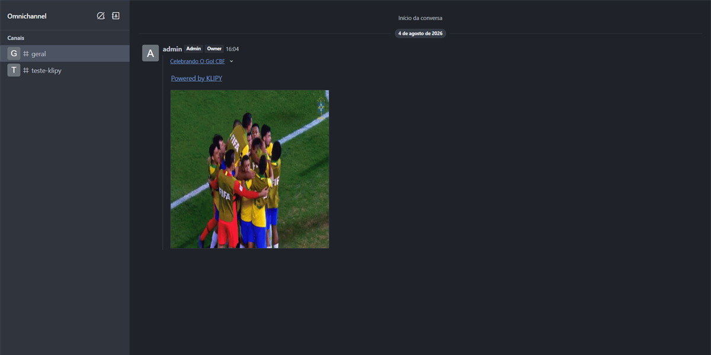

# KLIPY GIFs for Rocket.Chat

Pesquise e compartilhe GIFs do [KLIPY](https://klipy.com) sem sair da conversa.

**English:** [user guide](docs/USER-GUIDE.md).

```
/klipy comemoração
```

O Rocket.Chat mostra uma galeria de resultados, você escolhe um, e só o GIF escolhido
vai para a sala.

> **Integração de terceiros, não oficial.** Este App não é produzido, endossado nem
> patrocinado pelo KLIPY ou pelo Rocket.Chat. Ver [Integração não oficial](#integração-não-oficial).

---

## Índice

- [Visão geral](#visão-geral)
- [Screenshots](#screenshots)
- [Funcionalidades](#funcionalidades)
- [Requisitos](#requisitos)
- [Compatibilidade](#compatibilidade)
- [Como obter a API Key](#como-obter-a-api-key)
- [Instalação pelo Marketplace](#instalação-pelo-marketplace)
- [Instalação em ambiente de desenvolvimento](#instalação-em-ambiente-de-desenvolvimento)
- [Configurações](#configurações)
- [Uso](#uso)
- [Permissões](#permissões)
- [Privacidade](#privacidade)
- [Troubleshooting](#troubleshooting)
- [Desenvolvimento](#desenvolvimento)
- [Testes](#testes)
- [Empacotamento](#empacotamento)
- [Contribuição](#contribuição)
- [Licença](#licença)
- [Integração não oficial](#integração-não-oficial)
- [Atribuição ao KLIPY](#atribuição-ao-klipy)

---

## Visão geral

O App registra o slash command `/klipy`. Ao digitar um termo, o servidor Rocket.Chat
consulta a API do KLIPY e devolve miniaturas como preview. Ao escolher uma, o App
confirma o item na API e publica o GIF na sala.

```
Usuário
  ↓  /klipy comemoração
Slash command
  ↓
Apps-Engine (roda no servidor Rocket.Chat do seu workspace)
  ↓  GET https://api.klipy.com/v2/search
KLIPY API
  ↓  results[]
Galeria de preview  →  usuário escolhe
  ↓  GET https://api.klipy.com/v2/posts?ids=…   (confirma o item escolhido)
Mensagem publicada na sala
```

Não existe backend intermediário. Não há servidor, banco de dados nem serviço operado
pelo autor do App no caminho: seu workspace fala direto com o KLIPY, usando a chave que
o seu administrador configurou. Ver [PRIVACY.md](PRIVACY.md).

## Screenshots

Capturadas em 04/08/2026 num Rocket.Chat 6.13 real, em `960 × 540` (16:9) — o formato
exigido pelo Publisher Portal.

| # | Arquivo | Conteúdo |
|---|---|---|
| 1 | [`01-settings.png`](docs/screenshots/01-settings.png) | Configurações do App, com a API Key mascarada |
| 2 | [`02-typing.png`](docs/screenshots/02-typing.png) | `/klipy` no autocomplete, com a descrição traduzida |
| 3 | [`03-preview.png`](docs/screenshots/03-preview.png) | Galeria de resultados de `/klipy comemoração` |
| 4 | [`04-posted.png`](docs/screenshots/04-posted.png) | GIF publicado, com título e atribuição |
| 5 | [`05-i18n.png`](docs/screenshots/05-i18n.png) | A mesma tela em português e em inglês |





## Funcionalidades

- Slash command `/klipy <termo>` com galeria de preview selecionável.
- Publica somente o GIF escolhido — a consulta e os demais resultados não vão para a sala.
- Mensagens de ajuda e de erro são efêmeras: só quem executou o comando as vê.
- Interface em **português** e **inglês**, seguindo o idioma de cada usuário
  ([com uma ressalva](#idioma-das-mensagens)).
- Configuração por workspace: API Key, idioma da busca, filtro de conteúdo, número de
  resultados, exibição do título e do link de atribuição.
- Testado em canal público e dentro de thread. Canal privado e mensagem direta ainda não
  foram testados.
- Atribuição ao KLIPY sempre visível.

## Requisitos

- Rocket.Chat **6.13 ou superior** (ver [Compatibilidade](#compatibilidade)).
- Uma **API Key do KLIPY** por workspace ([como obter](#como-obter-a-api-key)).
- O servidor Rocket.Chat precisa alcançar `https://api.klipy.com`.
- Os clientes (navegador, desktop, mobile) precisam alcançar `https://static.klipy.com`,
  `https://static1.klipy.com` e `https://static2.klipy.com`, que é de onde a mídia carrega.

Se houver proxy ou firewall de saída, libere esses domínios em HTTPS/443.

## Compatibilidade

O manifesto declara `requiredApiVersion: "^1.46.0"`. Essa é a menor versão do
Apps-Engine que contém tudo o que o App usa, e corresponde ao Rocket.Chat 6.13.

| Rocket.Chat | Apps-Engine | Status | Observações |
|---|---|---|---|
| 6.13.0 | 1.46.0 | ✅ **Testado** — funciona | Piso declarado. Smoke test da 0.1.0 em 04/08/2026; 0.1.1 testada de ponta a ponta em 09/10/2026 |
| 7.0.x | 1.47.0 | ⚠️ Instala, não habilita | Ver *App privado* abaixo |
| 7.5.x | 1.50.0 | ⚠️ Não testado | |
| 7.10.0 | 1.55.0 | ⚠️ **Parcial** — instala e constrói, não habilita | Ver *App privado* abaixo |
| 8.0.x | 1.59.0 | ⚠️ Não testado | |
| < 6.13 | ≤ 1.45 | ❌ Não suportado | Abaixo do `requiredApiVersion` |

**O que foi de fato verificado**, em 04/08/2026, com Docker + WSL:

- **6.13.0** — instalação, ativação automática, registro do slash command, settings,
  galeria de preview, seleção, publicação e atualização preservando a API Key.
  Roteiro e resultado em [docs/smoke-test.md](docs/smoke-test.md).
- **7.10.0** — o pacote é aceito (HTTP 200) e o App é **construído sem erro**: os logs
  registram `app:construct`, `onInstall` e `initialize` limpos, com
  *"which depends on the API v^1.46.0!"*. Isso confirma que bundle, manifesto e
  `requiredApiVersion` são compatíveis com o 7.10. Só a **ativação** é recusada, por
  licença — não por incompatibilidade.

### App privado a partir do 7.0

Em Rocket.Chat 7.0+ sem plano premium, `licenses.info` traz
`preventedActions.privateApps: true`. O efeito observado é específico:

| Etapa | 6.13 Community | 7.10 Community |
|---|---|---|
| Upload do ZIP | ✅ | ✅ HTTP 200, App construído |
| Ativação | ✅ automática | ❌ `license-prevented` |

Ou seja, **o bloqueio é na ativação, não na instalação**. O App instalado pelo
Marketplace, caminho previsto para os usuários finais, não deve ser afetado, porque App
do Marketplace não é App privado. Isso não foi testado.

O App usa apenas APIs padrão do Apps-Engine, sem módulos nativos ou builtins de Node,
então deve rodar tanto no runtime Deno quanto no Node — isso ainda depende de
confirmação em runtime.

## Como obter a API Key

1. Acesse o [Partner Panel do KLIPY](https://partner.klipy.com/api-keys).
2. Vá em **API Keys** e clique em **Add Platform**.
3. Copie a chave gerada.

A chave nasce em **modo de teste**, limitada a **100 requisições por hora**. Cada GIF
enviado consome pelo menos 2 requisições: uma ou mais buscas da galeria enquanto o
usuário digita, e mais uma no envio. Por isso uma chave de teste sustenta menos de 50
envios por hora no workspace inteiro.

Para remover o limite, solicite **acesso de produção** pelo próprio Partner Panel.

> **A chave é sua, não do App.** Cada workspace obtém e administra a própria chave, com
> os próprios limites e a própria relação com o KLIPY. Este App não embute chave alguma
> e não intermedeia nada: quem instala fala direto com o KLIPY. Se o seu volume superar
> o limite de teste, o pedido de produção parte de você.

## Instalação pelo Marketplace

> O App ainda não foi publicado. Esta seção descreve o fluxo previsto.

1. Como administrador, abra **Administração → Marketplace**.
2. Procure por **KLIPY GIFs**.
3. Clique em **Install** e confirme as permissões apresentadas.
4. Abra as configurações do App e informe a API Key.
5. Em workspace de língua portuguesa, defina *Idioma da pesquisa* como `pt_BR`. Isso
   também define o idioma das mensagens do App para quem não escolheu idioma no perfil.
6. Em qualquer sala, teste com `/klipy comemoração`.

## Instalação em ambiente de desenvolvimento

Use uma instância dedicada de desenvolvimento — não o servidor de produção.

> **Sem acesso a um servidor Rocket.Chat?** Não é impedimento. Um workspace no
> **plano Starter** do Rocket.Chat Cloud é gratuito, permanente e permite subir App
> privado — que a partir do 7.0 virou recurso premium. Há também um
> [`docker-compose.yml`](docker-compose.yml) pronto na raiz. Os dois caminhos estão em
> [docs/installation.md](docs/installation.md#não-tem-acesso-a-um-servidor-rocketchat).

```bash
npm ci
npm run package
```

O ZIP sai em `dist/klipy-gifs_0.1.1.zip`. Suba por **Administração → Apps → Upload App**,
ou faça deploy direto:

```bash
npx rc-apps deploy --url http://localhost:3000 -u admin -p SUA_SENHA
```

Nunca coloque credenciais em arquivo versionado — passe por flag ou variável de
ambiente. Ver [SECURITY.md](SECURITY.md).

> A partir do Rocket.Chat 7.0, **subir Apps privados é recurso de plano pago**. Em um
> servidor Community 7.x você não conseguirá instalar o ZIP manualmente; use uma
> instância de desenvolvimento com licença de teste, ou aguarde a publicação no
> Marketplace. Detalhes em [docs/installation.md](docs/installation.md).

## Configurações

Todas ficam em **Administração → Apps → KLIPY GIFs → Settings**. Nenhuma é pública:
usuários comuns não conseguem lê-las.

| Setting | Id | Tipo | Padrão | Descrição |
|---|---|---|---|---|
| API Key do KLIPY | `klipy_api_key` | Password | *(vazio)* | **Obrigatória.** Chave do Partner Panel. Campo mascarado. |
| Idioma da pesquisa | `klipy_locale` | String | `en_US` | `xx` ou `xx_YY`. Valor inválido cai no padrão. Também define o idioma das mensagens do App para quem não escolheu idioma no perfil. |
| Filtro de conteúdo | `klipy_content_filter` | Select | `medium` | `off`, `low`, `medium` ou `high`. |
| Quantidade de resultados | `klipy_result_limit` | Number | `10` | Faixa 8–10 (ver nota). |
| Mostrar título do GIF | `klipy_show_title` | Boolean | `true` | Inclui o título do KLIPY na mensagem. |
| Transformar a atribuição em link | `klipy_show_attribution_link` | Boolean | `true` | Controla **apenas** o link. A atribuição é sempre exibida. |

**Sobre a faixa 8–10.** O Apps-Engine trunca o preview em 10 itens
(`ISlashCommand.previewer`: *"Max amount returned to the client is 10 and no more,
period."*), e o KLIPY recomenda 8 como mínimo em telas de busca. Pedir mais que 10
gastaria banda por resultados que o Rocket.Chat descartaria. Valores fora da faixa são
ajustados automaticamente, sem erro.

**Sobre o tipo da API Key.** O tipo é `PASSWORD` e não `STRING` — o contrato é o mesmo,
mas o Rocket.Chat mascara o campo na interface de administração.

## Uso

```
/klipy comemoração
/klipy bom dia
/klipy sexta-feira
/klipy congratulations
```

Digite o termo, escolha um GIF na galeria e ele é publicado. Se você confirmar sem
escolher nada, o App publica o **primeiro** resultado — o mais relevante segundo o
ranking do KLIPY.

`/klipy` sem termo mostra uma mensagem de ajuda visível só para você.

Dentro de uma thread, a mensagem é publicada na própria thread.

## Idioma das mensagens

Os textos traduzidos **pelo cliente** — descrição do comando, placeholder, rótulos dos
settings, título da galeria — sempre aparecem no idioma da interface. Isso funciona
porque o Rocket.Chat resolve essas chaves no navegador.

Já as mensagens que o App **monta no servidor** (ajuda e erros) dependem de o servidor
saber o idioma, e ele tem apenas duas fontes:

1. o idioma escolhido pelo usuário no perfil;
2. o setting *Idioma da pesquisa* do App (padrão `en_US`).

Quem nunca escolheu idioma no perfil recebe as mensagens no idioma da pesquisa. O App
traz português e inglês, e qualquer outro idioma cai no inglês. Com o padrão `en_US`,
as mensagens saem em inglês mesmo quando a interface aparece em português, porque o
Rocket.Chat traduz a interface pelo idioma do navegador, e essa informação não é
repassada aos Apps. O idioma padrão do workspace também não é usado, porque lê-lo
exigiria a permissão `server-setting.read` (ver [Permissões](#permissões)).

> **Recomendação ao administrador:** em workspace de língua portuguesa, defina
> *Idioma da pesquisa* como `pt_BR`.

## Permissões

Declaradas em [`app.json`](app.json). O Rocket.Chat as apresenta ao administrador
durante a instalação e bloqueia qualquer recurso não declarado.

| Permissão | Por que é necessária |
|---|---|
| `networking` | Chamar `https://api.klipy.com`. Sem ela o App não consegue buscar GIF nenhum. O manifesto restringe o escopo a `api.klipy.com`. |
| `slashcommand` | Registrar `/klipy`. É a única porta de entrada do App. |
| `message.write` | Publicar o GIF escolhido e enviar as mensagens efêmeras de ajuda e erro. |

Permissões **deliberadamente não pedidas**:

| Permissão | Por que não |
|---|---|
| `persistence` | O App não guarda nada. Sem histórico, sem cache, sem estado. |
| `message.read` | Não lê conversas. |
| `user.read` / `user.write` | Não consulta nem altera contas. O idioma vem do contexto do próprio comando. |
| `room.write` | Não cria nem modifica salas. |
| `upload.read` / `upload.write` | Não envia arquivos. A mensagem aponta para a URL do KLIPY, como o KLIPY exige. |
| `api` | O App não expõe endpoint HTTP. |
| `scheduler` | Não roda tarefas em segundo plano. |
| `ui.interact` / `ui.registerButtons` | A interação inteira acontece pelo preview nativo do slash command. |
| `server-setting.read` | Daria acesso a todos os settings do servidor. O idioma de fallback vem do setting do próprio App. |

> Nota técnica: o campo `domains` da permissão `networking` é declarativo. Ele
> documenta o destino para quem revisa o manifesto, mas as versões atuais do
> Apps-Engine não o aplicam como bloqueio em runtime.

## Privacidade

Resumo — o texto completo está em [PRIVACY.md](PRIVACY.md):

- O termo pesquisado é enviado ao KLIPY, porque é ele que gera os resultados.
- Não há backend do autor no caminho. Seu servidor fala direto com `api.klipy.com`.
- O App não guarda conversas, termos pesquisados, usuários nem qualquer outro dado.
- Não há telemetria, analytics ou envio de dados a terceiros.
- A API Key fica como setting privado do App, dentro do seu workspace.
- O App não envia identificador de usuário ao KLIPY (o parâmetro `customer_id` não é usado).
- A política de privacidade do KLIPY se aplica ao processamento feito pela API dele.

## Troubleshooting

| Sintoma | Causa provável | O que fazer |
|---|---|---|
| "O App KLIPY ainda não foi configurado." | API Key vazia | Preencha `klipy_api_key` nas configurações. |
| "Não foi possível autenticar na API do KLIPY." | Chave inválida, revogada ou com erro de digitação | Gere outra no Partner Panel e cole novamente. Cuidado com espaços no início/fim. |
| "O limite temporário de consultas ao KLIPY foi atingido." | Chave de teste estourou 100 req/h | Aguarde a virada da hora ou solicite acesso de produção. |
| "O serviço de GIFs está temporariamente indisponível." | Timeout, falha de rede, proxy bloqueando ou erro 5xx do KLIPY | Confirme que o servidor alcança `api.klipy.com` em HTTPS/443. |
| "O KLIPY retornou uma resposta inesperada." | Resposta fora do contrato — normalmente um proxy devolvendo HTML | Verifique se algo intercepta a saída HTTPS do servidor. |
| "Nenhum GIF foi encontrado para …" | Sem resultados para o termo | Tente outro termo ou reduza o filtro de conteúdo. |
| "Não foi possível publicar o GIF nesta sala." | O Rocket.Chat recusou a mensagem: sala só leitura (caso testado, em que o Rocket.Chat mostra também o aviso dele), usuário silenciado ou sala com criptografia ponta a ponta | Publique onde o usuário pode escrever. |
| A galeria não aparece enquanto digito | Chave ausente/errada, ou o KLIPY falhou | O preview fica em silêncio de propósito, para não notificar a cada tecla. Confirme o comando com Enter para ver a mensagem de erro. |
| A galeria aparece, mas o GIF não carrega na mensagem | Clientes sem acesso a `static*.klipy.com` | Libere os domínios de mídia para as máquinas dos usuários, não só para o servidor. |

Os logs do App ficam em **Administração → Apps → KLIPY GIFs → Logs**. Eles registram
operação, status HTTP, categoria do erro e duração — e nunca a API Key nem o termo
pesquisado.

## Desenvolvimento

```bash
npm ci            # instala as dependências
npm run verify    # i18n + tipos + lint + testes
```

Scripts disponíveis:

| Script | O que faz |
|---|---|
| `npm run i18n:build` | Regenera `i18n/en.json` e `i18n/pt.json` a partir de `i18n/strings.ts` |
| `npm run build` | Type-check (`tsc --noEmit`) |
| `npm run lint` | ESLint |
| `npm test` | Jest |
| `npm run verify:api` | Confere o contrato documentado contra a **API real** do KLIPY (precisa de `KLIPY_API_KEY` no ambiente) |
| `npm run test:coverage` | Jest com cobertura |
| `npm run package` | ZIP compilado, em `dist/` |
| `npm run package:source` | ZIP com o código-fonte, em `dist/` |
| `npm run deploy` | `rc-apps deploy` |
| `npm run verify` | i18n + build + lint + test |

Estrutura:

```
KlipyApp.ts               classe do App: registra settings e o slash command
commands/KlipyCommand.ts  executor, previewer e seleção
services/KlipyClient.ts   único ponto que conhece o formato da API do KLIPY
settings/                 ids, limites, registro e leitura validada dos settings
types/klipy.ts            modelo interno (KlipyGif) e tipos da resposta bruta
utils/validation.ts       validação de consulta, URL, locale, limites e sanitização de log
utils/media.ts            escolha de formato e normalização dos resultados
utils/messages.ts         montagem do anexo publicado e da atribuição
i18n/strings.ts           fonte única de todo texto visível
docs/                     contrato da API, instalação, submissão, plano de testes
```

**Todo texto visível mora em `i18n/strings.ts`.** Os arquivos `en.json` e `pt.json` são
gerados a partir dele — edite o `.ts` e rode `npm run i18n:build`. Um teste falha se os
dois saírem de sincronia.

## Testes

```bash
npm test
```

200 testes em 7 suítes, cobrindo o cliente HTTP, a normalização de mídia, a validação,
a montagem das mensagens, os settings, o slash command e o catálogo de i18n. Nenhum
deles toca a rede: as fixtures em `tests/fixtures/` foram derivadas dos exemplos
publicados na documentação do KLIPY e não contêm chave nenhuma.

Cobertura das camadas testáveis fora do Apps-Engine: **99% das linhas, 96% dos ramos**
(`npm run test:coverage`).

Há testes dedicados a garantir que a API Key não aparece em log, em mensagem de erro
nem na serialização da exceção — inclusive quando o próprio erro de rede repete a URL
chamada.

## Empacotamento

```bash
npm run package          # dist/klipy-gifs_0.1.1.zip
npm run package:source   # dist/klipy-gifs_0.1.1_source.zip
```

Os dois scripts chamam `rc-apps package` a partir de uma cópia limpa do App, montada
em `.package-build/` e removida ao final. O motivo está documentado no cabeçalho de
[`scripts/package.js`](scripts/package.js): o compilador do CLI varre o projeto inteiro
e compila todo arquivo `.ts` que encontra — ignorando apenas `node_modules` e `.git`, e
sem consultar `.rcappsconfig` ou `tsconfig.json` nessa fase. Qualquer arquivo de teste
na árvore quebraria o empacotamento.

## Suporte

Antes de abrir um chamado, veja o [SUPPORT.md](SUPPORT.md) — a tabela de sintomas cobre
a maioria dos casos, e os logs do App (Administração → Apps → KLIPY GIFs → Registros)
podem ser anexados com segurança, porque não contêm a API Key nem o termo pesquisado.

Chamados: <https://github.com/RafaelGFavero/rocketchat-klipy/issues>

Vulnerabilidades: **não** abra issue pública — ver [SECURITY.md](SECURITY.md).

## Contribuição

Issues e pull requests são bem-vindos.

Antes de abrir um PR, rode `npm run verify` e garanta que está verde. Mudanças no
cliente HTTP devem vir acompanhadas da atualização de
[docs/api-contract.md](docs/api-contract.md).

**Nunca cole uma API Key em issue, PR, log ou screenshot.** Se acontecer, revogue a
chave imediatamente no Partner Panel — ver [SECURITY.md](SECURITY.md).

## Licença e termos

Código sob [MIT](LICENSE). O uso do App está sujeito aos [Termos de Uso](TERMS.md), e o
uso da API do KLIPY, aos termos do próprio KLIPY — sua chave, sua relação com eles.

Nenhum código foi copiado dos projetos
[Rocket.Chat.App-Tenor](https://github.com/wreiske/Rocket.Chat.App-Tenor) ou
[Rocket.Chat.App-Giphy](https://github.com/wreiske/Rocket.Chat.App-Giphy). Eles foram
consultados apenas como referência de comportamento — como um slash command de GIF com
preview se estrutura. A implementação, o UUID e o ícone são novos e originais.

## Integração não oficial

Este é um App de terceiros. Não é produzido, endossado, patrocinado nem afiliado ao
KLIPY ou ao Rocket.Chat.

"KLIPY" é marca de seu respectivo titular. O nome é usado aqui apenas de forma
descritiva, para indicar com qual API o App se integra. O projeto **não distribui
logotipo nem material de marca do KLIPY** — o ícone é uma criação original. Caso o
titular da marca exija mudanças de nomenclatura, elas serão feitas.

## Atribuição ao KLIPY

As diretrizes do KLIPY pedem:

| Requisito | Situação |
|---|---|
| `"Search KLIPY"` como placeholder padrão do campo de busca — **obrigatório** | ✅ É o `i18nParamsExample` do comando, ou seja, o texto que o Rocket.Chat exibe ao lado de `/klipy` |
| Marca d'água do KLIPY no card da mensagem — opcional | ➖ Não implementado: exigiria distribuir material de marca |
| `"Powered by KLIPY"` visível onde o conteúdo aparece — opcional | ✅ Em toda mensagem publicada e no título da galeria de preview |

A atribuição textual **não pode ser desativada**. O setting
`klipy_show_attribution_link` decide apenas se ela vira um link para `klipy.com`.

Todo o conteúdo é fornecido pelo KLIPY e está sujeito aos termos dele. As URLs de mídia
são usadas exatamente como recebidas, sem reescrita, cache ou re-hospedagem, conforme os
*Integration Requirements* do KLIPY.
